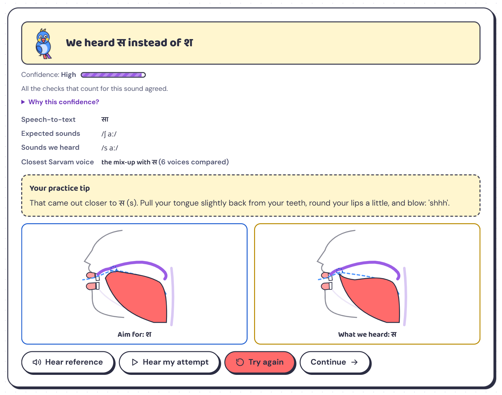

# Kili AI — SayBetter speech practice for Tamil & Hindi

A learner says a word. SayBetter checks the **one sound that matters**, tells them which sound it actually heard
(“We heard स instead of श”), shows the tongue and lips for both sounds side by side, gives one specific tip, and moves
their practice plan up or back based on saved results. Kili the parrot (*kili* is Tamil for parrot) keeps them company.

> Practice support only. SayBetter does not diagnose speech disorders or replace a speech-language therapist.



## What's inside

| | |
|---|---|
| Sounds | Tamil ழ ள ர · Hindi र श ख — 5 levels each, from single sounds to everyday sentences |
| Three checks per attempt | Sarvam speech-to-text (`saaras:v3`, verbatim) · a phoneme model (`wav2vec2-xlsr-53-espeak-cv-ft`) · comparison with 6 Sarvam voices saying the word correctly and with each mix-up |
| Honest confidence | Each check counts in proportion to its measured accuracy for that sound ([accuracy report](docs/accuracy-report.md)); below 55 % the app says “not sure” |
| Adaptive plan | 3 of the last 4 on target → level up · 3 of 4 mixed up → level down · stuck at level 1 → suggests a therapist |
| Privacy | Recordings are deleted after analysis unless the learner opts in; each browser holds a secret profile key; one-tap delete |

Docs: [feature showcase](docs/SayBetter_Feature_Showcase.docx) · [project summary](docs/SayBetter_AI_Summary.docx) ·
[market research](docs/SayBetter_Market_Research.docx) · [screenshots](docs/screenshots)

## Architecture

```
Browser ──► Vercel (static frontend/)  ── /api/* rewrite ──►  Hugging Face Docker Space (backend/, FastAPI)
                                                                 ├─ Sarvam speech-to-text + text-to-speech
                                                                 ├─ wav2vec2 phoneme model (CPU, baked into the image)
                                                                 └─ SQLite (resets when the Space restarts)
```

- `frontend/` — plain HTML/CSS/JS, no build step (Baloo 2 / Baloo Thambi 2 / DM Sans, animated SVG mouth diagrams, Kili).
- `backend/app/` — FastAPI: `analysis.py` (pipeline + confidence), `compare.py`, `engines/` (sarvam, phonemes, templates),
  `planner.py`, `coach.py`, `data/targets.json` (practice content), `data/calibration.json` (measured accuracy).
- `backend/tools/calibrate.py` — re-measures accuracy with Sarvam voices (~₹18 per full run).

## Run locally (Windows)

```powershell
powershell -ExecutionPolicy Bypass -File run.ps1
```

Then open http://localhost:8000 in Chrome or Edge. Put your Sarvam key in `backend/.env` (copy `backend/.env.example`).
The first run creates a Python 3.12 environment in `%LOCALAPPDATA%\SayBetter\venv` and downloads the ~1.2 GB model.

## Deploy

1. **Backend — Hugging Face Space** (Docker SDK, free CPU): upload this repo (it has a `Dockerfile`), then add a
   secret `SARVAM_API_KEY` in the Space settings. The app listens on port 7860.
2. **Frontend — Vercel**: import this repo; `vercel.json` serves `frontend/` and forwards `/api/*` to the Space.

## Limits

- Accuracy was measured on synthetic Sarvam voices; real learners need validating with native speakers. Tamil ழ and ள are weakest.
- The free Space sleeps when idle (first request wakes it in ~1 minute) and its SQLite data resets on restart.
- Practice tips and diagrams are drafts that need review by a speech-language therapist.
